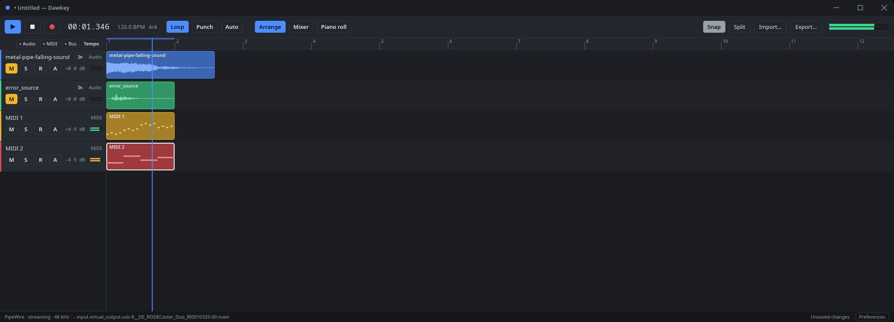
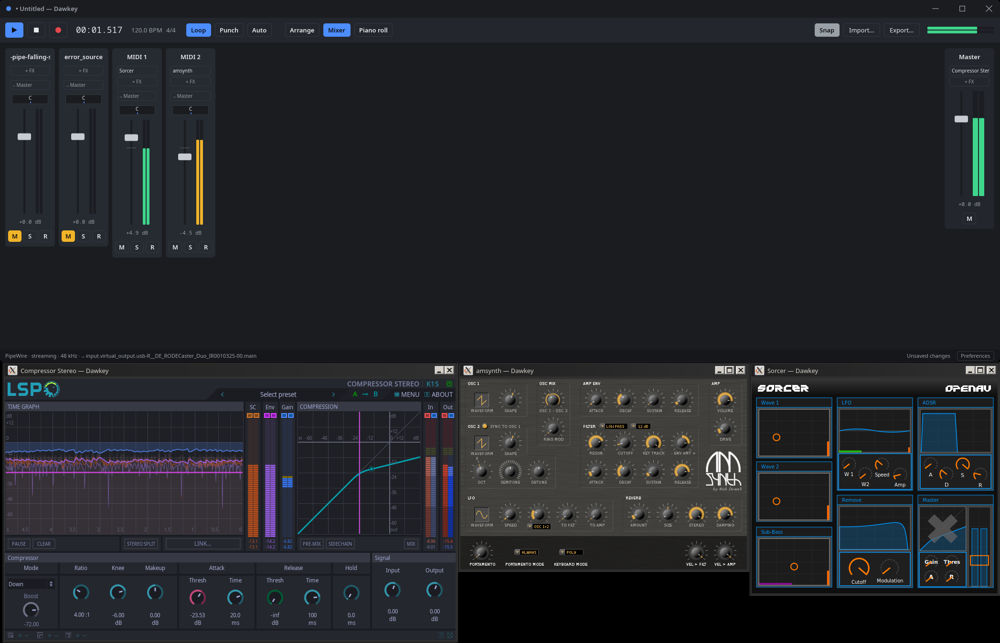
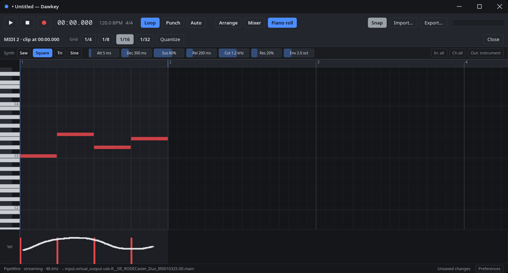
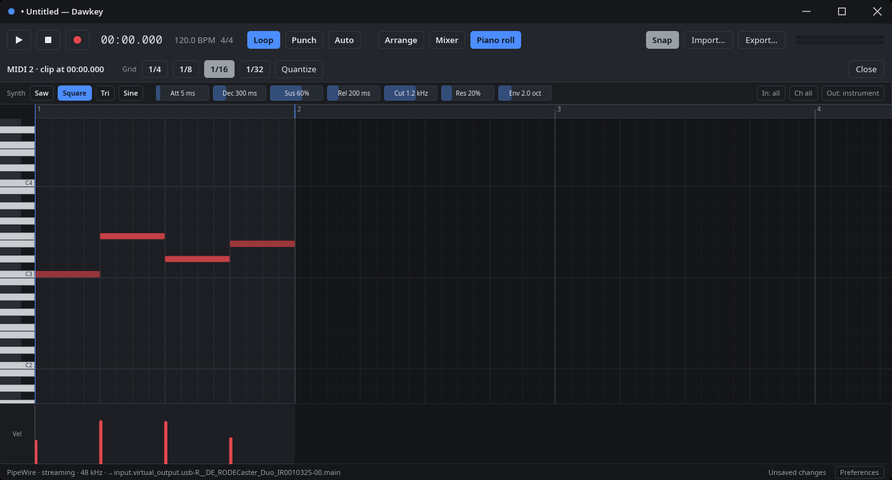

# Dawkey

Dawkey is a digital audio workstation (DAW) for the Linux desktop, written in Rust. It records, arranges and mixes audio and MIDI, hosts CLAP, LV2 and VST3 plugins, and has an MCP server built in, so AI assistants and test scripts can drive it.

It is made for one kind of desktop and nothing else:

- **Wayland only.** Dawkey draws its own window decorations and never uses X11 itself. Plugins' own GUIs are the exception: they run through XWayland, in the plugin's own process.
- **PipeWire and WirePlumber only.** There are no JACK or ALSA backends.
- **MCP built in.** Everything you can do in the window, including clicking and taking screenshots, can also be done over the [Model Context Protocol](https://modelcontextprotocol.io).

> **Status: early development.** Dawkey can record, edit, mix and export a song, but expect rough edges and missing features.

## Features

### Recording and editing

- Audio tracks with waveforms. Move, trim, split, copy, paste and repeat clips, with snapping to beats.
- Recording from the default input, with loop takes, punch in and out, take lanes and comping, input monitoring, and latency compensation.
- Undo and redo for every edit. Projects are saved as `.dawkey` bundles, with autosave and crash recovery.
- Importing audio (WAV, FLAC, MP3, Ogg, AIFF and more) and Standard MIDI Files, by drag and drop or from the file dialog.

### MIDI

- MIDI tracks with a built-in 16-voice polysynth, or a plugin instrument.
- A piano roll with velocity and controller lanes, and quantizing.
- Live MIDI input and output through PipeWire, MIDI recording, and per-track device and channel choice.
- A tempo map with ramps and a time signature map. MIDI keeps its bars and beats when the tempo changes.
- MIDI 2.0 per-note controllers and note expressions.

### Mixing and plugins

- A mixer with faders, pan, meters, buses and a master bus.
- CLAP, LV2 and VST3 plugins, with a generic parameter editor, sidechains, multiple outputs and delay compensation.
- Plugins' own GUIs. By default each plugin file runs in a sandboxed process of its own, so a crashing plugin can't take Dawkey down.
- Automation lanes for gain, pan and plugin parameters, drawn by hand or recorded in touch, latch or write mode.

### Export

- WAV (16 or 24-bit, or 32-bit float) and FLAC (16 or 24-bit), with dither, sample rate conversion and loudness analysis.

### Desktop

- Fractional scaling, a dark and a light theme (following the desktop's setting), UI scaling, and keyboard shortcuts.

### MCP

- 84 tools covering the project, the transport, recording, MIDI, plugins, automation, rendering and the user interface.
- Three ways to connect: stdio for a headless instance, a Unix socket for the running window, and opt-in HTTP on loopback with a token.
- A headless mode with a virtual audio clock, which makes end-to-end tests deterministic.

## Screenshots

The arrange view: audio and MIDI tracks, with the playhead looping over the first bar.



The mixer, with LSP Compressor Stereo on the master and the Sorcer and amsynth instruments on the MIDI tracks. Each plugin's own GUI runs in a process of its own.



The piano roll. Drawing across the velocity lane (left) sets the velocity of each note the stroke passes over (right).

| Drawing a stroke                                                                   | The velocities it set                                                            |
| ---------------------------------------------------------------------------------- | -------------------------------------------------------------------------------- |
|  |  |

Automation: gain and plugin parameter lanes edited in the arrange view while the loop plays, and the mixer's faders following them.

<video src="screenshots/Automation-Demo.webm" controls muted width="100%"></video>

If the video doesn't play here, [download it (WebM)](screenshots/Automation-Demo.webm).

## Installing

Packages for Fedora 44, Debian 13, Ubuntu 26.04 and Arch Linux, and a tarball for other distributions, are on the [Releases page](https://github.com/quonic/dawkey/releases). [packaging/README.md](packaging/README.md#installing-a-release) shows how to install them.

On anything else, or to run the latest code, build Dawkey from source.

## Building from source

Dawkey needs Rust 1.88 or newer (edition 2024) and a few system libraries.

### Build dependencies

Fedora 44 (what CI builds on):

```sh
sudo dnf install cargo rust gcc gcc-c++ clang-devel pkgconf-pkg-config \
    pipewire-devel lilv-devel libxkbcommon-devel wayland-devel \
    qt5-qtbase-devel qt6-qtbase-devel
```

Debian 13 and Ubuntu 26.04 (install Rust with [rustup](https://rustup.rs); the distribution's Rust may be too old):

```sh
sudo apt install build-essential clang libclang-dev pkg-config \
    libpipewire-0.3-dev liblilv-dev libwayland-dev libxkbcommon-dev \
    qtbase5-dev qt6-base-dev
```

Arch Linux:

```sh
sudo pacman -S --needed base-devel rust clang pipewire lilv libxkbcommon \
    wayland vulkan-icd-loader qt5-base qt6-base
```

What they're for:

- libclang: bindgen uses it to generate the PipeWire bindings.
- PipeWire: the audio and MIDI backend.
- lilv: LV2 plugin hosting.
- libxkbcommon and Wayland: the window and keyboard input.
- A C++ compiler and the Qt 5 and Qt 6 headers: a small shim that shows LV2 plugins' Qt UIs. Dawkey doesn't link against Qt; the plugin's UI brings it. Without the headers Dawkey still builds, and says so when such a UI is opened.
- VST3 needs nothing extra. Its bindings, generated from Steinberg's MIT-licensed VST 3 SDK headers, come with the `vst3` crate.

### Build and run

```sh
cargo build --release
./target/release/dawkey                    # open the window
./target/release/dawkey Song.dawkey        # open a project
```

### Runtime requirements

- A Wayland compositor. Dawkey doesn't run on X11.
- PipeWire and WirePlumber. Headless instances on the virtual audio backend don't need them.
- A Vulkan driver: Mesa (AMD, Intel, or lavapipe, the software renderer) or NVIDIA's proprietary driver.

Optional:

- `xdg-desktop-portal` and a backend for your desktop (`-gnome`, `-kde` or `-gtk`): open and save dialogs, and following the desktop's light or dark setting. Without them, dialogs don't open and the theme stays dark unless the preferences pick one. Dragging files onto the window works either way.
- XWayland: plugins' own GUIs. CLAP GUIs, VST3 editors and LV2 X11 UIs are shown through XWayland from the plugin's process.
- Gtk 2 or 3, or Qt 5 or 6: LV2 plugin UIs written with them. Dawkey loads these libraries only when such a UI opens. A plugin's package usually brings them along.
- Plugins. Dawkey finds CLAP, LV2 and VST3 plugins in the standard locations, in `$CLAP_PATH`, `$LV2_PATH` and `$VST3_PATH`, and in folders added in the preferences. `lsp-plugins` and `zam-plugins` are good ones to start with.

## Using Dawkey

- Preferences (Ctrl+,) are kept in `~/.config/dawkey/preferences.json`. They cover the audio backend, plugin folders and sandboxing, autosave, theme, UI scale and MCP over HTTP.
- `dawkey --help` lists the command-line options. For example, `--audio virtual` runs without PipeWire.
- Projects are folders named `Name.dawkey` that hold `project.json` and the project's audio.
- Recordings made before a project is first saved are kept in `~/.cache/dawkey/recordings` until it is.

The [keyboard and mouse reference](docs/SHORTCUTS.md) lists the shortcuts and gestures.

## Driving Dawkey over MCP

Each running window serves MCP on a Unix socket that only you can reach. A headless instance serves it on stdio:

```sh
dawkey mcp --headless [Song.dawkey]   # no window, virtual audio clock
dawkey mcp --attach                   # bridge stdio to the running window
```

For example, to let Claude Code drive the window you have open:

```sh
claude mcp add dawkey-live -- dawkey mcp --attach
```

In this repository, Claude Code picks up both servers from [.mcp.json](.mcp.json): `dawkey` (headless) and `dawkey-live` (the running window).

MCP over HTTP is opt-in, for clients that can't start a command. See [docs/MCP.md](docs/MCP.md) for HTTP, the tools, and how to write tests with it.

## Documentation

- [docs/MCP.md](docs/MCP.md): connecting MCP clients, the tools, and testing over MCP
- [docs/SHORTCUTS.md](docs/SHORTCUTS.md): keyboard shortcuts and mouse gestures
- [docs/ARCHITECTURE.md](docs/ARCHITECTURE.md): how Dawkey is built, crate by crate
- [docs/PLAN.md](docs/PLAN.md): the roadmap, and notes on each milestone
- [packaging/README.md](packaging/README.md): installing releases, and building packages
- [CONTRIBUTING.md](CONTRIBUTING.md): building, testing and sending changes
- [SECURITY.md](SECURITY.md): the security model, and reporting vulnerabilities

## Contributing

Bug reports, ideas and pull requests are welcome. Start with [CONTRIBUTING.md](CONTRIBUTING.md). Everyone taking part is expected to follow the [code of conduct](CODE_OF_CONDUCT.md).

## License

Dawkey is free software under the GNU Affero General Public License, version 3 or (at your option) any later version. See [LICENSE](LICENSE).

The embedded fonts, Noto Sans and Noto Sans Mono, are under the SIL Open Font License 1.1 ([crates/dawkey-text/assets/fonts](crates/dawkey-text/assets/fonts)).
